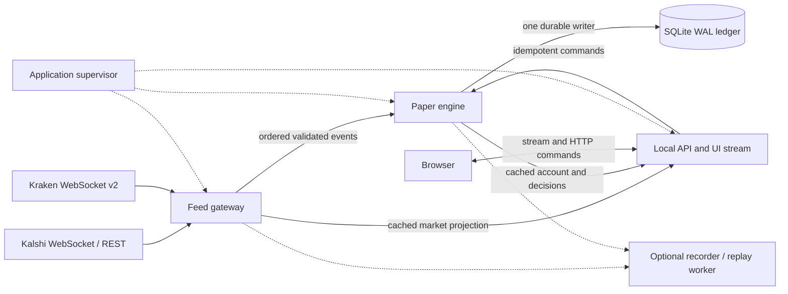

# Kalshi terminal rebuild blueprint

Prepared October 18, 2026. Reviewed repository: `MGM-EE/Kalshi-Bot-V2`, commit `ce0f3d0`.

Status: original rebuild proposal, supported by a code audit and local reproductions. The first connectivity stage is now implemented; see the [connectivity update](../connectivity_update.md) for the shipped scope and limitations. The broader process architecture and acceptance targets below remain a plan. The original [verification report](verification.md) records the pre-change baseline. [build-backlog.csv](build-backlog.csv) is the longer-term implementation queue.

## The idea, recovered

Build a dependable desktop research terminal for Kalshi's 15-minute BTC, ETH, and SOL contracts. It combines executable Kalshi prices, the contract's actual CF Benchmarks reference, and Kraken spot order flow to explain a possible entry or exit, then tests those decisions with realistic paper execution and an auditable ledger.

The main promise is operational: **the terminal detects bad data, explains what stopped, repairs the connection automatically when possible, and resumes only after validating fresh data.** The browser can close and reopen without owning the feed or trading lifecycle.

Product priorities, in order:

1. Correct, continuous data and automatic recovery.
2. Small and predictable processing delay.
3. Correct paper balances, fills, risk controls, and settlement.
4. Clear explanations of readiness and decisions.
5. Strategy customization, indicators, and research tools.

Keep paper trading as the execution scope established by the original brief. Keep BASELINE V1 immutable, custom profiles versioned, existing position criteria pinned, and CF reference prices separate from Kraken spot prices. A missing reference blocks dependent entries; a protective sell can still proceed with a valid executable Kalshi book and applicable fees. Closed markets go to official settlement reconciliation.

The first useful build is deliberately small: three market cards, working feed recovery, source ages, manual paper orders, positions, and an incident timeline. Add automation and advanced research only after the feed acceptance gate passes.

## What the audit found

The current code already has Decimal accounting, checksum/sequence checks, idempotent paper requests, persistence, replay, and browser HTTP fallback. Those are valuable foundations. The weaknesses are in lifecycle coordination and failure isolation.

| Priority | Finding and evidence | Effect | Required change |
|---|---|---|---|
| P0 | `frontend/src/connection.ts:86`: replacement requires `ws === null`; only `onclose` clears it. Locally simulated a socket stuck CLOSING for one hour: one socket created, no replacement. | Recovery can wait indefinitely for a close event. This reproduces a mechanism consistent with the reported symptom, not its confirmed cause on the PC. | Give every socket attempt a generation and an absolute deadline. Retire expired generations locally and reconnect without depending on `onclose`. |
| P0 | `connectors/kalshi.py:359` sets `stream_live` after sends, before acknowledgements or book snapshots. `poll_asset` checks that one flag. Local reproduction: socket live, book invalid, zero fallback requests. | A missing subscription can disable fallback indefinitely while unrelated messages arrive. | Track readiness per asset/channel. Keep an independent REST view until the corresponding WS book is validated; never merge REST into a delta chain. |
| P0 | `connectors/kalshi.py:231` raises for every subscription error; `retry` calls venue-wide invalidation. Local reproduction: an error for CF request 2 invalidated two otherwise valid books. | One unavailable channel takes down usable market data and exits. | Correlate request IDs and subscription IDs; isolate capability failures from transport failures. |
| P0 | Both connectors check socket activity, but no independent worker repairs a stale required subscription while other messages keep arriving. | A socket can look live while one asset/channel remains unusable. | Subscription deadlines, a channel watchdog, and targeted resynchronization. Quiet trade channels need different treatment from periodic CF ticks. |
| P0 | `main.py:69–75` starts background tasks without a runtime supervisor. Completed/failed tasks are gathered only at shutdown. | An unexpected connector or settlement task exit can leave a functioning HTTP server with a dead worker. | Supervise task exit and progress; publish degraded readiness and restart the failed component. |
| P1 | Market/lifecycle revisions end the entire Kalshi session (`kalshi.py:360`). | Normal 15-minute rollover or metadata events interrupt CF and unrelated assets. | Maintain desired subscriptions and reconcile them using supported update commands. Stage the next market before cutoff. |
| P1 | Discovery, fee requests, and fallback polls run serially in one REST loop (`kalshi.py:394`). Each HTTP request has a 15-second timeout. | A slow metadata request delays fallback for other assets; refresh period includes request time. | Separate discovery, fees, fallback, and settlement schedules behind a shared rate budget and bounded concurrency. |
| P1 | SQL transactions, strategy work, observer calls, and per-client full snapshots share the exchange event loop. Strategy evaluation is gated to 250 ms; UI frames are scheduled every 500 ms. | Computation/disk delays can compete with socket reads. Current code also imposes deliberate decision/display delay. | Isolate the feed runtime; compute projections once; move SQL and research work off its loop. |
| P1 | Health uses a general 15-second threshold for most channels. A new snapshot recomputes read models and source-age displays. | Too permissive for some entry decisions, too strict for naturally quiet trade streams; HTTP responsiveness is weak evidence of worker health. | Separate transport liveness, subscription readiness, book integrity, observation continuity, and execution eligibility. |

Source paths in the table are relative to `backend/app/` unless they name the frontend. The original Windows/network cause remains unproven. Do not treat another frontend cosmetic change as an explanation for the exchange or worker failures.

## Architecture decision

Keep Python, asyncio, FastAPI, TypeScript, and SQLite. Rewrite the connection lifecycle and runtime boundaries. Preserve tested financial rules through adapters and regression fixtures. No Kafka, Redis, Kubernetes, new language, or external database is needed for this three-asset desktop application. Reconsider a lower-level parser/runtime only if profiling after isolation shows it misses the latency budget.

Run three supervised local processes from one installed application, plus an optional research process:



- **Feed gateway:** owns exchange connections, HTTP clients, authentication, subscription reconciliation, authoritative books, monotonic freshness, and normalization. Its event loop never runs SQL, strategy calculations, analytics, or UI rendering. Connector tasks are independently supervised inside this process.
- **Paper engine:** owns decision state, indicators, commands, risk, execution, and settlement accounting. A single serialized ledger owner performs durable SQLite transactions. Reads use published projections. Feed consumption and safety timeouts continue while a dedicated ledger worker is busy; a hung ledger worker makes trading unavailable and causes supervised recovery. Do not share a live SQLite connection among arbitrary executor threads.
- **Local API/UI process:** serves the frontend, cached projections, diagnostics, and command acknowledgements. Many tabs read the same precomputed state. It cannot mutate the ledger directly. Killing it does not stop exchange ingestion or the paper engine.
- **Optional research process:** consumes recorded copies and runs replay/analytics with CPU and memory limits. Recording overflow marks the recording incomplete; it must not back up live ingestion. Replay uses an isolated database and cannot address the active account.
- **Application supervisor:** manages children, progress heartbeats, exclusive instance/account locks, restart budgets, log rotation, graceful shutdown, and a new runtime ID after every restart. A parent that cannot recover exits visibly so the OS service/task can restart it.

Use persistent, length-prefixed JSON over authenticated loopback TCP for local process communication, including Windows. Bind only to loopback and use a generated per-launch token passed through restricted local configuration, not the browser. Limit message size, queue bytes, and queue age. Separate control/health from the ordered event lane. Measure IPC before considering a binary encoding. Never expose the local API publicly as part of this build.

This introduces some process-management work, but makes the main failure boundary explicit: slow UI/research/disk work cannot stop the exchange socket reader. Start with the gateway and thin engine consumer; do not extract all existing modules at once.

## Connection and recovery contract

### Model transport and data independently

Transport states: `STOPPED → CONNECTING → AUTHENTICATING → SUBSCRIBING → ACTIVE`, with `BACKOFF` for temporary errors and `BLOCKED_CONFIGURATION` for unusable credentials. `ACTIVE` means the connection works; it does not imply every channel is ready.

Each `(venue, asset, channel)` tracks `UNREQUESTED`, `AWAITING_ACK`, `AWAITING_SNAPSHOT`, `READY`, `QUIET`, `STALE`, `RESYNCING`, or `UNAVAILABLE_CAPABILITY`. Store requested parameters, request ID, SID, connection epoch, last sequence, acknowledgement deadline, last accepted event, last verification, and the next repair deadline.

Each transition must have an owner, timestamp, reason code, and a bounded next action. A websocket open event or subscription ACK never qualifies as a valid book. An ACK for CF also does not prove the requested index exists; check the available index list and actual ticks. See the [Kalshi subscription protocol](https://docs.kalshi.com/websockets/websocket-connection) and [CF availability workflow](https://docs.kalshi.com/websockets/cfbenchmarks-value).

### Recovery ladder

1. Detect a lost connection, missing ACK/snapshot, broken sequence/checksum, missed periodic feed, or stalled internal consumer.
2. Mark only affected data ineligible immediately; clear dependent confirmation/warmup state. Preserve the last values for display with explicit age and status.
3. Repair the narrowest valid scope: request a fresh Kalshi book snapshot; reconcile a missing subscription; unsubscribe/resubscribe a Kraken book when its protocol supports the required reset. Track all acknowledgements.
4. Escalate to a venue reconnect when targeted repair times out, integrity cannot be established, or transport fails. Regenerate authentication headers and restore desired subscriptions every time.
5. Establish a new connection/book epoch. Ignore messages from retired epochs. Validate new snapshots and recover continuity-dependent indicators before enabling affected entries.
6. If configuration or permissions prevent recovery, keep the usable capabilities running and show a persistent, actionable reason. Automatically retry on credential/configuration changes; re-probe a blocked capability at a low rate rather than creating a reconnect storm.

The current Kalshi API supports `get_snapshot`, `add_markets`, and `delete_markets` on orderbook subscriptions. Prefer these over tearing down the whole connection; verify the actual response sequence rules in fixtures and authenticated acceptance. A sequence gap in a shared SID invalidates every book covered by that sequence scope until resynchronized. Validate sequence-bearing protocol messages before filtering out markets. See [orderbook updates](https://docs.kalshi.com/websockets/orderbook-updates).

REST books stay in a separate generation and are labeled polling. They can support an explicitly eligible paper exit after their own age, fees, and depth checks, but cannot repair a WS delta chain or establish complete trade flow. Switching sources resets continuity-dependent signals. A late REST response can never overwrite a newer WS state; compare asset/market/source generation and request version before accepting it.

### Initial timing defaults

These are starting configuration values to tune on the real Windows machine, not measured guarantees.

| Mechanism | Starting policy |
|---|---|
| Connection / ACK / initial snapshot | 10 s connection; 5 s ACK; 5 s snapshot deadlines, enforced independently |
| Exchange transport | Client ping every 5 s; pong deadline 3 s; transport blackhole detection target within 10 s. Handle server control pings independently of application JSON. |
| Kalshi CF normal feed | Expected roughly 1 Hz; block dependent entries after 3 s without a valid source tick; start targeted repair. Never refresh its age from a ticker, ping, or HTTP response. |
| Entry book age | Start at 2 s since last accepted update or verified fresh snapshot; otherwise block and request verification. Reuse a verified unchanged book only within this bound. |
| Trade stream silence | No universal time-since-last-trade reconnect rule. Distinguish a quiet market from lost transport/subscription or a known data gap. Flow windows carry continuity and sample counts. |
| Quiet books | Healthy transport alone does not establish book freshness. Request a WS snapshot when verification is needed; deduplicate/rate-limit requests. If verification cannot meet the entry age bound, stay blocked. |
| Reconnect | One prompt retry after a previously healthy connection; then jittered exponential backoff, with an explicit attempt budget and max 30 s delay. Use at least 5 s between Kraken retries during maintenance/extended downtime. Reset only after sustained channel readiness. |
| REST fallback | Per-asset 2 s target, adaptive to the account's documented rate budget; bounded concurrency 3, per-request deadlines and exponential backoff on failures. Honor `Retry-After` and never let metadata consume the entire budget. |
| Browser | 8 s connect deadline; stale warning at 3 s without backend progress; HTTP backup with a bounded request; retire an expired socket generation without waiting for its close callback; retry with jitter capped at 8 s. |
| Child processes | Progress heartbeat every 1 s; degraded after 3 s; restart after 10 s without progress, subject to the component's shutdown/restart policy. A heartbeat must report completed work, not just a running timer. |

Kalshi sends server Ping control frames every 10 s; the library should answer them automatically. They do not reach JSON `recv()` and must not be confused with book/reference progress. See [keep-alive](https://docs.kalshi.com/websockets/connection-keep-alive). Kraken heartbeat messages describe socket liveness; its reconnect limits and maintenance guidance constrain retry policy. See [Kraken heartbeat](https://docs.kraken.com/exchange/api-reference/spot-websocket-v2/heartbeat) and [connection guidance](https://docs.kraken.com/exchange/guides/websockets/introduction).

### Rollover without a venue reset

Discover the current and next rounds ahead of time; cache rule/fee metadata with explicit expiry. Subscribe to the next book when the venue permits and stage its snapshot in a separate market generation. At the actual contract cutoff, atomically select the validated next market. Keep CF and Kraken connected. Remove the old book subscription after transition; retain position/settlement records. Closed positions stay in reconciliation even after the UI selects a new round. Unknown next-market rules, missing snapshots, delayed discovery, and early lifecycle changes block entries for that market without disrupting other assets.

## Data integrity and backpressure

Use an explicit versioned event envelope:

```json
{
  "schema_version": 1,
  "runtime_id": "random-per-launch",
  "connection_epoch": 7,
  "market_generation": 12,
  "venue": "kalshi",
  "asset": "BTC",
  "channel": "book",
  "subscription_id": 41,
  "sequence": 1092,
  "received_monotonic_ns": 123456789000,
  "received_utc_ms": 1790000000000,
  "source_utc_ms": 1790000000000,
  "book_revision": 803,
  "kind": "book_update",
  "payload": {}
}
```

The numbers are illustrative. UTC source time measures exchange age and supports audit/replay; monotonic time controls timeouts and local latency. Clock jumps cannot extend eligibility or resurrect old data. For IPC comparisons, use one documented host-wide monotonic clock and validate it across child processes during startup. Never compare monotonic values across machine/reboot boundaries.

- Preserve every accepted book delta in order through validation. Never silently drop or coalesce deltas before book reconstruction. Preserve trade IDs and source timestamps; deduplicate by ID, not timestamp alone.
- Bound each event queue by bytes, count, and oldest-event age; initial engine-lane budget: 8 MiB / 8,192 events / 250 ms, whichever is reached first. Validate these capacities under measured real bursts.
- On overflow or consumer lag, increment that consumer epoch, revoke its execution readiness over the control lane, purge invalid backlog, publish a gap marker and full current book, and rebuild dependent windows. The gateway keeps ingesting. If control delivery also fails, engine freshness/progress deadlines independently block trading.
- A missed trade interval is a research/flow gap. Do not claim a book snapshot restores missing flow. Resume each indicator only when its own warmup/coverage requirement passes.
- Coalesce only derived UI projections, keeping the latest version. A slow browser gets a current full compact snapshot rather than a growing queue of obsolete frames.
- The engine evaluates an immutable input version, journals its intent, then rechecks current market/epoch, cutoff, book age, fees, and risk before a fill transaction. An intent whose durable commit finishes after its execution deadline is rejected at that post-commit check. Record the input revision, validation/fill time, durable acknowledgement time, and final rejection/fill separately.

## Low-latency path

1. Timestamp receipt immediately, parse once, validate, apply the book/trade, publish an ordered event.
2. Update incremental indicators for the affected asset. Cache results by input/config version; avoid rescanning every 5-minute history on every request.
3. Coalesce strategy triggers for at most 10 ms; use a 50 ms timer for time-only conditions. Preserve explicit strategy confirmation windows and simulated order latency.
4. Route paper intents to the durable ledger owner. Keep SQLite WAL and durable commits; reducing durability is not a latency optimization. Cache portfolio/decision views after accepted changes.
5. Publish a small UI projection at 5–10 Hz. Load deep books, rules, logs, and analytics on demand. Rendering and display traffic never drive strategy ticks.

Measure stage times, p50/p95/p99, queue age, loop lag, and process CPU/RSS under an identified machine, feed rate, account size, and tab count. The V2 synthetic check measured a source-update pair p95 of **0.029 ms** and an all-asset **indicator** snapshot p95 of **14.59 ms**. It omits network receipt, parser work, full account snapshots, durable commits, and browser rendering; it does not prove end-to-end latency.

### Proposed acceptance targets

| Metric | Gate / interpretation |
|---|---|
| Gateway receive → validated publish | p95 ≤ 5 ms; p99 ≤ 20 ms at the declared baseline load |
| Eligible received event → strategy evaluation | p95 ≤ 25 ms; p99 ≤ 50 ms, excluding deliberately configured signal-confirmation time |
| Paper command → durable acknowledgement | p95 ≤ 100 ms on reference SSD; measure separately from configured simulated fill delay |
| Input accepted → visible compact UI | p95 ≤ 250 ms in a visible foreground tab on the same machine |
| Event-loop scheduling lag | Gateway p99 ≤ 10 ms; no unexplained pause ≥ 100 ms in normal-load testing |
| Abrupt disconnect | Start reconnect promptly; after network/service restoration, validated data returns within 10 s p95 in controlled tests. Report detection, retry, and warmup separately. |
| Silent required CF channel | Mark ineligible at 3 s; attempt narrow repair without waiting for unrelated channels to stop |
| Browser return from sleep/network loss | Current backend snapshot within 5 s after connectivity returns in controlled tests; never depend indefinitely on an old close event |
| Endurance | 72 h unattended, including at least 100 market transitions; no unhandled dead workers or manual recovery; stable queues and bounded memory |
| Internal availability | Target ≥ 99.9% eligible processing time while verified upstream/network/configuration are healthy. Publish raw downtime too; exclusions cannot hide internal stalls. |

Run baseline at the observed peak event rate plus 10× bursts, a small and a 100,000-fill ledger, one and five browser tabs, with recording on/off and replay running. Replace the provisional rate with measured p99 one-second event volume before signing off. Also run a slower Windows reference machine; do not infer Windows performance from this cloud host. Exchange/network outages are outside a local latency promise.

## The interface

Use four primary views:

1. **Live:** BTC/ETH/SOL market cards, executable YES/NO quotes, actual contract cutoff, CF line/reference, and a concise current entry/exit explanation.
2. **Paper account:** cash, reservations, positions, orders/fills, pause/emergency controls, and profile versions pinned to positions.
3. **Connections:** separate rows for browser, gateway, engine, and each required source/channel; age, state, reason, last repair, attempt count, and next action. Show “Kraken connected; Kalshi reference unavailable; entries blocked” rather than a single misleading global light.
4. **Research:** recorder coverage, replay, comparisons, and analytics, loaded separately from live operations.

Keep last known values visibly stale. Distinguish “entries disabled by you,” “entries blocked by missing data,” “engine unreachable,” and “browser reconnecting.” Reconnection never silently enables a paused strategy. An automatic data block may clear after readiness and warmup recover if the user's saved enable state permits it. Commands carry stable IDs; after an ambiguous response, query/retry the same ID before creating a new command.

## Build sequence and release gates

| Stage | Deliverable | Exit gate |
|---|---|---|
| 0 — Evidence and fixtures | Preserve current version; capture sanitized incident history and local reproductions; baseline latency/loop lag | The CLOSING trap, missing-book fallback suppression, and CF error blast radius are repeatable failures in the harness |
| 1 — Recovery core | State machines, request/SID registry, epochs, channel watchdog, retry policy, browser generation deadlines, supervised tasks | Every required local fault recovers to validated data or an explicit configuration/capability block; nothing waits forever |
| 2 — Feed gateway | Independent runtime, bounded IPC, separate REST schedulers, rollover reconciliation, engine readiness fencing | Kill/hang API, engine, or research without starving exchange reads; overflow and sequence gaps never yield eligible stale data |
| 3 — Paper engine | Adapt current Decimal books/risk/fill/fees/settlement/profile rules; one durable owner, event-driven decisions | Existing financial invariants pass; crash recovery produces no duplicate orders/fills and no balance change from migration |
| 4 — Compact UI | Cached projection service, browser recovery, clear per-source diagnostics and idempotent commands | Sleep/resume, network switching, slow tabs, restarts, and delayed responses pass; display p95 target passes |
| 5 — Research and packaging | Isolated recorder/replay, Windows installation/supervision, diagnostics export, versioned backup/rollback | 72 h soak, authenticated Kalshi/CF, rollover, Windows credential and restart tests pass on the intended machine |

Stages depend on the preceding gate; advanced indicators do not substitute for feed acceptance. A rough planning range is **4–6 focused engineer-weeks**, including integration and a 72-hour soak, assuming usable authenticated feed access and access to a Windows test machine. Re-estimate after Stage 1; this is an effort estimate, not a delivery date. Detailed dependencies and acceptance checks are in the CSV backlog.

### Failure-injection acceptance matrix

| Injected condition | Required result |
|---|---|
| TCP reset / DNS failure / network blackhole | Bounded detection and retry; no stale fills; new snapshot required after reconnect |
| Browser OPEN or CLOSING never completes | Expire its generation and connect a replacement; old callbacks cannot update current state |
| Other channels active, one required feed missing | Per-channel ineligibility and repair; usable unrelated channels continue |
| Missing/delayed/rejected ACK or snapshot | Deadline fires; error classified; fallback remains independently available |
| CF unavailable or one index absent | Keep books and protective exits available; show the missing capability; block only dependent entries |
| Book gap, duplicate, out-of-order update, bad CRC | Correct subscription-scope invalidation, resnapshot, and warmup; zero trades from corrupt data |
| Idle market with working transport | No reconnect storm from absent trades; explicit book verification before execution |
| Market rollover / early close / late lifecycle | No venue reset on normal rollover; no old-market entry; official settlement continues |
| HTTP 429/5xx, slow metadata, late fallback response | Shared rate budget and isolated deadlines; no source/version rewind |
| NTP clock jump / Windows sleep / Wi-Fi change | Monotonic deadlines expire correctly; revalidate source time and snapshots on resume |
| Slow browser / heavy replay / database stall / queue overflow | Feed gateway remains responsive; affected engine blocks; gaps are explicit and recoverable |
| Worker crash / hung worker / parent restart | Visible degradation; bounded restart; exclusive ledger ownership; restored pending intents remain idempotent |
| Credentials repaired while running | Safe reload/re-auth without reinstall; no credentials in UI/logs/diagnostic exports |
| Shutdown during intent/fill/settlement transaction | Ledger recovers atomically; no duplicated cash/inventory movement; incomplete recording is marked |

## Migration and operations

Build in a new V3 package beside V2. Do not delete the current folder, reset the account, or rewrite the existing database in place. Freeze V2 writes for a consistent SQLite backup using the SQLite backup API (or a clean shutdown); copying only the main file while WAL is active is insufficient. Verify balances, reservations, quantities, open intents, profile/config versions, and a ledger digest before importing to a copy.

Run V3 with a separate account for initial feed/fault testing. For financial comparison, feed captured events into isolated copies and compare ledger/decision outputs; differences need an explicit explanation, especially after changing the strategy scheduler. Real active-account paper execution has one owner. After cutover, rollback means stop V3, reconcile/export any new ledger changes, and then reopen a compatible account with V2. Never discard new fills by blindly restoring an old backup.

Move mutable data/logs outside the versioned installation folder. On Windows use the user's local application-data directory and retain compatibility with the existing DPAPI credential store. A user-scoped scheduled task/service starts the supervisor and restarts failures; browser closure has no effect on it. Prevent sleep while the user explicitly requests continuous operation, and explain that an offline/sleeping PC cannot ingest live feeds. Resume must always resynchronize rather than reuse pre-sleep eligibility.

Diagnostics should record safe reason codes, connection/channel generations, close codes, sanitized protocol error codes, last progress, queue age, loop lag, and repair transitions. Rotate logs and cap disk usage. Export a redacted bundle without API IDs, signing keys, private paths, balances, or account data. A “Retry connection” action can accelerate an allowed retry; it cannot bypass readiness, permissions, or rate limits.

## Immediate implementation starting point

Take backlog items R01–R08 first: establish the fault harness, fix browser generation retirement, implement explicit subscription readiness/fallback separation, correlate errors, add targeted repair and task supervision. The first reviewable milestone is a small live-data terminal that survives those faults repeatedly. Only then move the financial engine and richer UI onto it.
